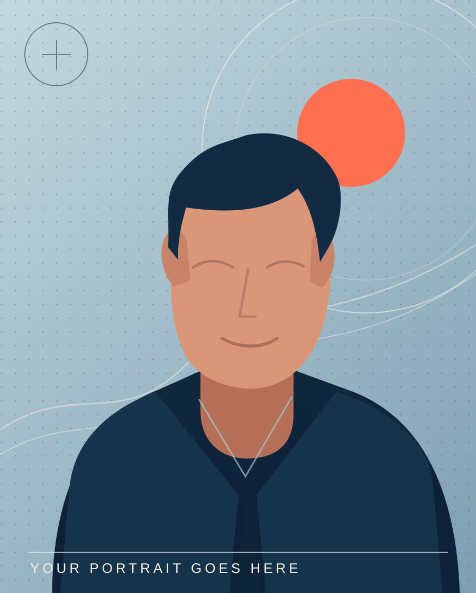

# Rahil Roshan — Bespoke Portfolio

A photo-first, editorial developer website built completely from scratch using **HTML + CSS**. No JavaScript, frameworks, build steps, or dependencies are required. Fonts load from Google Fonts when an internet connection is available; attractive local fallbacks are provided.

## Open the website

1. Extract the ZIP file.
2. Open `index.html` in Chrome or use **VS Code → Live Server → Open with Live Server**.
3. Browse the page, including the mobile layout.

## Add your own photograph (important)

Your photo has a prominent place on the **right side of the hero section**, with a decorative blue background, a slight tilt, a signature seal, and a caption.

1. Put your photograph in the `assets` folder and name it `rahil-photo.jpg`. A clear vertical portrait, roughly 4:5 or 3:4, works best.
2. Open `index.html` and find this line:

```html

```

3. Change it to:

```html

```

4. To adjust how your face sits in the crop, edit `object-position: center 27%;` under `.portrait-photo` in `style.css` (for example, try `center 15%` or `center 40%`). You do **not** need to crop your photo first.
5. When you have replaced the photo, change the text `YOUR PHOTO GOES HERE` in the hero caption to `THE PERSON BEHIND THE CODE` (or any caption you like).

## Personalize

- **Name / introduction**: edit the hero and About section in `index.html`.
- **GitHub**: currently links to https://github.com/rahildotcodes. Update if needed.
- **Projects**: the three example projects are Indoor Wayfinder, Expense Tracker API and Diet Planner App. Their graphics are intentionally built in HTML/SVG/CSS so you don't need screenshots.
- **Email / LinkedIn**: not included because no addresses were provided. You can add links to the header, contact area or footer. To use email, add an anchor with `href="mailto:your-real-email@example.com"` after substituting your real address.
- **Colors**: edit the `--paper`, `--ink`, `--blue`, `--coral` and other variables at the start of `style.css`.
- **Sections**: About, Selected Work, Expertise, Education & Direction, Contact.

## Publish using GitHub Pages

1. Make a new public repository (e.g. `rahil-portfolio`).
2. Push all project files, keeping `index.html`, `style.css`, and `assets` in the root.
3. In GitHub, open repository **Settings → Pages**. Under **Build and deployment**, select **Deploy from a branch**; choose `main` and `/(root)`; save.
4. GitHub will show the website URL once deployment completes.

## Accessibility & performance

- Semantic headings, landmarks, a skip link, visible focus styles, text alternatives, keyboard-accessible native `details` mobile menu.
- Responsive desktop/tablet/mobile layout; no horizontal scrolling expected at standard device widths.
- Respects `prefers-reduced-motion`.
- Static HTML/CSS works offline except for optional web font loading.

---

Design concept: **"The Art of Making It Work"** — editorial typography, photographic layering, custom project illustration and a purposeful cobalt/coral palette. Designed specifically for Rahil Roshan, not generated from a generic portfolio theme.
